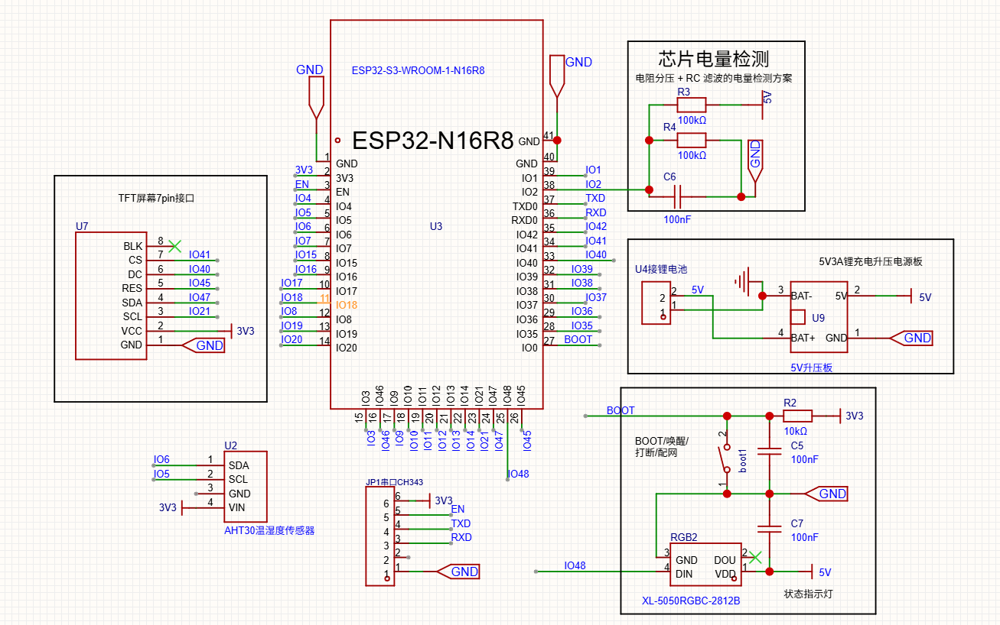
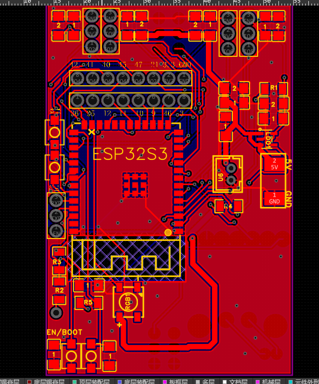
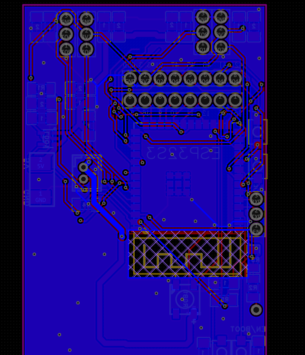
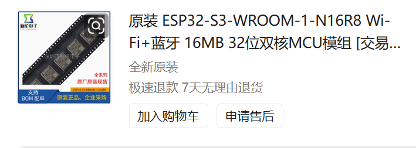
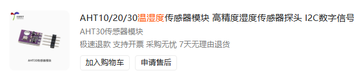
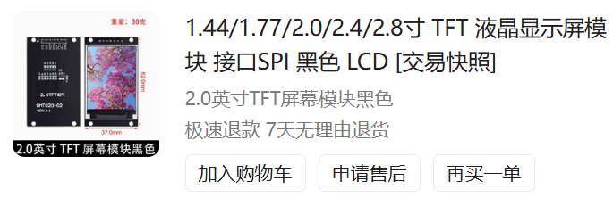
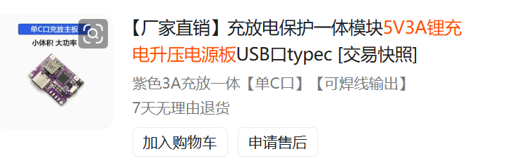
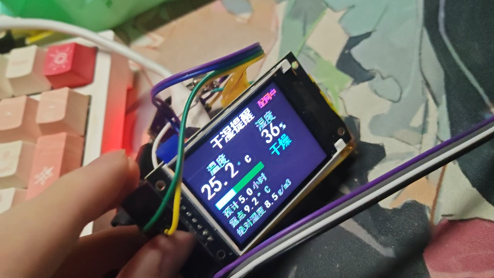
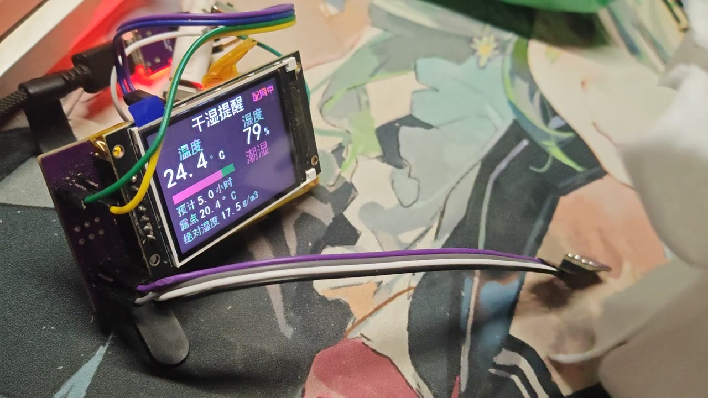
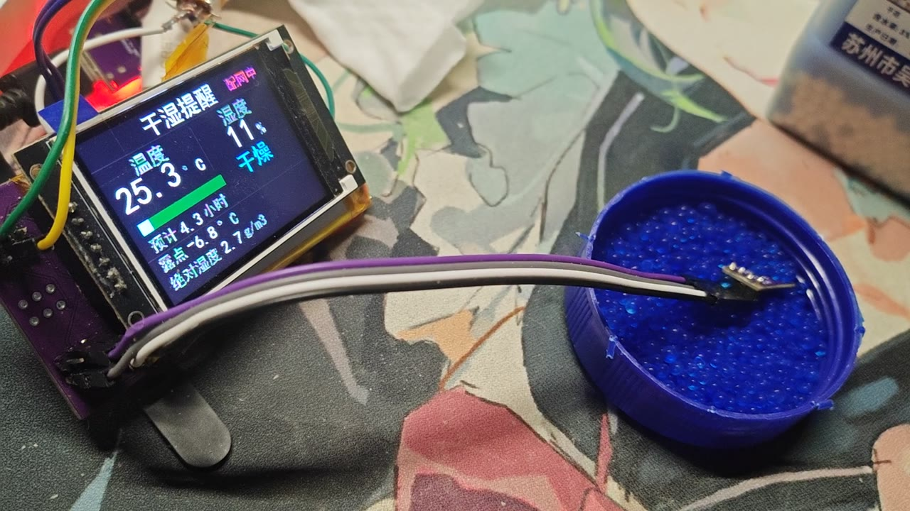

# 智能干湿提醒衣架 (Smart Dry-Rack)

基于 ESP32-S3 的晾衣架干湿提醒器：用 AHT30 采集温湿度，屏幕直接显示「干燥 / 适宜 / 偏潮 / 潮湿」，
联网后把数据推送到 webhook（企业微信 / 钉钉 / 飞书 / Bark / 自建服务），
并支持低功耗模式——关屏后每 30 分钟自动唤醒采集上报一次，按 BOOT 键随时唤醒。


## 功能

| 功能 | 说明 |
|------|------|
| 干湿分级 | 按相对湿度分 4 档，配色显示，另给出露点、绝对湿度、低温提示 |
| 预计干衣 | 按湿度指数衰减趋势外推剩余干燥时间，无历史时用 VPD 物理模型兜底 |
| 屏幕显示 | 320×240 横屏直驱帧缓冲，无 LVGL，实时刷新（1 秒） |
| WiFi 联网 | STA 连接路由器，定时推送温湿度到 webhook |
| 手机配网 | 首次开机自动开热点，手机浏览器填 WiFi 和通知地址，无需重新编译 |
| 本地网页 | 局域网内访问设备 IP 可直接看实时数据、下发休眠指令 |
| 低功耗 | 关屏 + 关闭 WiFi，每 30 分钟 RTC 定时唤醒采集上报，BOOT 键唤醒 |
| RGB 指示 | WS2812B 按干湿等级显示绿 / 黄 / 红 |

## 硬件

| 元件 | 型号 |
|------|------|
| MCU | ESP32-S3-WROOM-1-N16R8 (Octal PSRAM 8MB) |
| 显示屏 | ST7789V SPI TFT 320×240 |
| 温湿度传感器 | AHT30 (I²C 0x38) |
| RGB 灯 | WS2812B 5050 |
| ~~气体传感器~~ | ~~SGP30~~ **已拆除** |

### 引脚连接

板型在 `idf.py menuconfig` → **Dry Rack 干湿衣架** → **硬件板型** 里选择，默认「原 ESP32-S3-WROOM-1 板」，
这一项对应的就是下面这张原理图的自制板。

下表由仓库内 [原理图](docs/hardware/schematic.png) 逐脚核对得出：

| 功能 | 本板（原理图） | Freenove 板 |
|------|---------------|-------------|
| I²C SDA | IO6 | IO1 |
| I²C SCL | IO5 | IO2 |
| LCD SCK | IO21 | IO21 |
| LCD MOSI | IO47 | IO42 |
| LCD RST | IO45 | IO45 |
| LCD DC | IO40 | IO40 |
| LCD CS | IO41 | IO41 |
| LCD 背光 BLK | **悬空（常亮）** | — |
| WS2812B DIN | IO48（VDD 接 5 V） | IO48 |
| 重启键 | IO38 | IO38 |
| 开关机键 | IO39 | IO39 |
| BOOT 键（唤醒源） | IO0（R2 10K 上拉 + C5 100nF） | IO0 |
| 电池电压检测 | IO2（R3/R4 100K 分压 + C6 100nF） | — |

> ⚠️ ESP32-S3 只有 **GPIO0 ~ GPIO21** 属于 RTC IO，能在深睡中作为唤醒源。
> 本项目用板载 **BOOT 键 (GPIO0)** 做唤醒，开关机键 (IO39) 只负责「进入低功耗」。

### 本板的三个硬件约束

**1. TFT 背光 BLK 悬空 —— 软件关不掉背光**

原理图里 TFT 7pin 的 `BLK` 脚打了叉（未连接），背光直接由模块 VCC 供电、上电常亮。

后果是低功耗模式只能把 LCD 控制器 `DISPOFF` 成黑屏，**背光仍会持续耗电（十几 mA 量级）**，
深睡周期里的平均功耗会被它拉高。

想真正省电可以飞一根线，把 `BLK` 改接到某个空闲 IO（例如 IO19 / IO20），
再到 menuconfig 里填 **LCD 背光控制 GPIO**，休眠时就会把它拉低。

**2. IO2 已被电池电压检测占用**

原理图右上角「芯片电量检测」用 R3/R4 各 100 K 分压、C6 滤波，把电池电压送进 **IO2**。

所以：
- 这块板**不能**选 Freenove 板型（它把 I²C 配到 IO1/IO2，会与分压电路打架）
- IO2 不要拿去做别的用途，悬空时也会被分压网络影响

固件目前还没有读取这个电压，属于硬件预留。

**3. 电源**

电池经 **5V3A 充放升压板**输出 5 V，5 V 直接给 WS2812B，再经板上稳压得到 3.3 V 供 MCU 与传感器。
所以低功耗时的实际功耗还要算上升压板自身的静态损耗，电池端会比芯片端高一些。

## 硬件资料

原始资料（原理图、PCB、器件购买截图）已归档到 [`docs/hardware/`](docs/hardware/)。

### 原理图

<a href="docs/hardware/schematic.png"></a>

<sub>点击查看原图。包含 ESP32-S3-WROOM-1-N16R8 主控、AHT30 温湿度、TFT 7 pin 接口、WS2812B、
BOOT/唤醒键、芯片电量检测与 5 V 升压电源五部分。</sub>

原理图里有几处对写固件特别有用的信息：

| 区域 | 读出来的结论 |
|------|-------------|
| TFT 7 pin 接口 | `SCL=IO21`、`SDA=IO47`、`RES=IO45`、`DC=IO40`、`CS=IO41`、`BLK` **未连接** |
| AHT30 | `SDA=IO6`、`SCL=IO5`，VIN 接 3V3，对应代码里的默认板型 |
| BOOT/唤醒/配网 按键 | 按下拉低到 GND，R2 10 K 上拉到 3V3，C5 100 nF 消抖 → 可直接做 `ext0` 深睡唤醒源 |
| 芯片电量检测 | R3/R4 各 100 K 分压后接到 **IO2**，C6 100 nF 滤波 |
| RGB2 / WS2812B | `DIN=IO48`，`VDD=5 V` |
| 串口 | IO43 / IO44（UART0），经 CH343 引出到 JP1 |

### PCB

| 顶层布局 | 底层走线 |
|:---:|:---:|
| <a href="docs/hardware/pcb-top.png"></a> | <a href="docs/hardware/pcb-routing.png"></a> |

### 主要器件

| 器件 | 实物 | 说明 |
|------|------|------|
| **ESP32-S3-WROOM-1-N16R8** |  | 16 MB Flash + 8 MB Octal PSRAM，双核 240 MHz |
| **AHT30 温湿度模块** |  | I²C 地址 0x38，3.3 V 供电，兼容 AHT10/20 协议 |
| **2.0 寸 TFT SPI 屏** |  | ST7789V 驱动，7 pin 排针，320×240 |
| **5V3A 锂电充放升压板** |  | 单 Type-C 口，内置充放电保护，输出 5 V 给灯珠与 LDO |

## 界面

```
┌────────────────────────────────────┐
│  干湿提醒                  已联网  │  标题 + 联网状态
├────────────────────────────────────┤
│   温度            湿度             │
│  25.5 °C          65 %             │
├────────────────────────────────────┤
│ ████████████░░░░       适宜        │  湿度条 + 干湿状态
│ 预计 3.5 小时                      │  预计干衣时间
├────────────────────────────────────┤
│ 露点 12.3°C                        │
│ 绝对湿度 9.8 g/m3     低温慢干     │
└────────────────────────────────────┘
```

### 实拍

演示视频（56 秒）里的三个关键画面，正好覆盖完整的晾晒过程：

<table>
<tr>
<td align="center"></td>
<td align="center"></td>
<td align="center"></td>
</tr>
<tr>
<td align="center"><b>初始 25.2°C / 36%</b><br>判定「干燥」，预计 5.0 小时</td>
<td align="center"><b>挂上湿毛巾后 79%</b><br>越过阈值，状态切为「潮湿」</td>
<td align="center"><b>水分蒸发后 11%</b><br>回到「干燥」，预计 4.3 小时</td>
</tr>
</table>

> 中间湿度峰值一度冲到 90% 以上（接近 AHT30 满量程），随后随毛巾失水回落。
> 全程由固件自动判定等级、切换配色、重算干衣时间，无需人工干预。

### 干湿判定规则

按相对湿度分档（阈值可在 [`app_config.h`](main/app_config.h) 调整）：

| 湿度 | 状态 | 颜色 | 晾衣建议 |
|------|------|------|----------|
| ≤ 45 % | 干燥 | 青色 | 衣物易干 |
| 45 ~ 62 % | 适宜 | 绿色 | 正常晾晒 |
| 62 ~ 78 % | 偏潮 | 黄色 | 干得慢 |
| > 78 % | 潮湿 | 红色 | 不易干、易返潮 |

温度低于 12 °C 时额外提示「低温慢干」。同时计算并上报：

- **绝对湿度** `AH = 216.7 × e / (T + 273.15)`（g/m³），e 为水汽分压
- **露点** 用 Magnus 公式推导，判断是否容易结露返潮

### 预计干衣时间

界面和推送里都会给出「预计 X.X 小时」（不足 1 小时显示分钟）。设备内部走两条路径：

**1. 指数衰减外推（有历史时优先）**

衣物水分蒸发速率正比于剩余含水量，环境基本稳定时，晾晒过程中的相对湿度按指数下降：

```
RH(t) = RH_floor + A · e^(-k·t)
```

每 60 秒记一个采样点，保留最近 96 个（约 1.6 小时）。当样本 ≥ 10 且湿度确实在下降，
对 `ln(RH − RH_floor)` 做最小二乘拟合求衰减常数 k，再外推到目标湿度（历史最低点 + 2 %）：

```
剩余时间 = ln((RH_now − RH_floor) / (RH_goal − RH_floor)) / k
```

**2. VPD 物理模型（历史不足时兜底）**

刚上电、低功耗刚唤醒、或湿度还没开始下降时，用饱和水汽压差估算：

```
es(T) = 6.112 × exp(17.67·T / (T + 243.5))     // hPa
VPD   = es(T) × (1 − RH/100)
预计小时数 = 103 / VPD
```

经验常数按「25 °C / 50 %RH ≈ 6.5 小时」标定，可在 [`app_core.c`](main/app_core.c) 的 `ETA_VPD_K` 调整。

**自动识别挂衣**：湿度在 1 分钟内突升超过 6 %RH 会被判定为「刚挂上湿衣服」，历史曲线自动清空重记；
也可调用 `app_core_eta_reset()` 手动重置。超过 48 小时无法给出有意义的估计时显示 `--`。

## 编译

需要 ESP-IDF **v5.5 或 v6.1**（本仓库在 v6.1 上验证通过）。

```bash
. $IDF_PATH/export.sh      # Windows: . $env:IDF_PATH\export.ps1

idf.py set-target esp32s3
idf.py menuconfig          # 按需选板型 / 修改低功耗间隔
idf.py build
idf.py -p COM3 flash monitor
```

工程不依赖任何托管组件（已去掉 `lvgl`、`led_strip`），首次编译无需联网下载。

## 首次配网

1. 烧录后设备启动，若 NVS 里没有 WiFi 凭据，会自动开热点：
   - SSID：`DryRack-XXXX`（XXXX 为 MAC 后 4 位）
   - 密码：`dryrack123`
2. 手机连上该热点，浏览器打开 **http://192.168.4.1/**
3. 填写：
   - **WiFi 名称 / 密码**（2.4 GHz）
   - **通知地址**（webhook，见下节，可留空）
   - **通知格式**
4. 点「保存并重启」，设备重启后按 STA 模式连接路由器。

> 换了路由器或密码？**长按 BOOT 键 8 秒**会清除 WiFi 配置并重启，重新进入配网模式。

## webhook 通知格式

在配网页面选择格式，服务端会收到对应的请求：

### 0 · 通用 JSON（默认）

`POST` 到你的地址，`Content-Type: application/json`：

```json
{
  "device": "dryrack",
  "id": "A1B2C3",
  "temp": 25.5,
  "humi": 65,
  "level": "normal",
  "status": "适宜",
  "dew": 18.1,
  "ah": 14.2,
  "eta_min": 210,
  "eta_src": "trend",
  "cold": false,
  "uptime": 3600
}
```

`eta_min` 是预计剩余干燥分钟数（`-1` 表示暂时无法估算），`eta_src` 标明来源：
`trend` = 按历史趋势外推，`vpd` = 物理模型兜底，`none` = 无数据。

### 1 · 企业微信 / 钉钉 机器人

```json
{"msgtype":"text","text":{"content":"【干湿衣架 A1B2C3】适宜\n温度 25.5°C，湿度 65%\n露点 18.1°C，绝对湿度 14.2 g/m3\n预计干衣：约 3.5 小时"}}
```

### 2 · 飞书 机器人

```json
{"msg_type":"text","content":{"text":"【干湿衣架 A1B2C3】适宜..."}}
```

### 3 · Bark (iOS)

`GET {你填的地址}/{URL 编码后的消息}`，即把消息直接拼在路径后面。

> HTTPS 地址可用，固件内置了 CA 证书包（`CONFIG_MBEDTLS_CERTIFICATE_BUNDLE`）。

## 低功耗模式

### 进入方式

- **长按开关机键 (IO39) 2 秒**
- 局域网访问 `http://<设备IP>/api/sleep`
- 手机页面上的休眠链接

### 低功耗时做什么

1. 冻结采集任务，关闭屏幕显示（DISPOFF）并关闭背光（若配置了背光 GPIO）
2. 关闭 WS2812B、停止 WiFi 与 HTTP 服务
3. 配置两个唤醒源后进入 deep sleep：
   - **RTC 定时器**：`CONFIG_DRYRACK_SLEEP_INTERVAL_MIN` 分钟（默认 30）后唤醒
   - **BOOT 键 (GPIO0)**：按下立即唤醒

### 唤醒后的行为

| 唤醒原因 | 行为 |
|----------|------|
| RTC 定时器 | **静默周期**：不点屏，采 3 次取平均 → 连 WiFi → 推送 webhook → 继续睡 |
| BOOT 键 | **正常模式**：点亮屏幕，恢复实时显示与联网 |
| 复位 / 重新上电 | 正常模式 |

### 背光很重要

本项目这块板子的 TFT `BLK` 引脚是**悬空**的（见[本板的三个硬件约束](#本板的三个硬件约束)），
背光直接由模块 VCC 供电，所以深睡时屏幕虽然全黑，背光仍在耗电。

如果希望低功耗真正省电，把 `BLK` 飞线接到空闲 IO（例如 IO19 / IO20），然后在 menuconfig 里填写：

```
Dry Rack 干湿衣架 → LCD 背光控制 GPIO → 填你的 IO 号
```

默认 `-1` 表示不受控。

## 按键

| 按键 | 操作 | 功能 |
|------|------|------|
| IO38 | 短按 | 重启 |
| IO39 | 长按 2 秒 | 进入低功耗模式 |
| BOOT (IO0) | 长按 8 秒 | 清除 WiFi 配置并重启（重新配网） |
| BOOT (IO0) | 深睡时按下 | 唤醒并回到正常模式 |

## 目录结构

```
env_monitor/
├── main/
│   ├── main.c              # 入口：按唤醒原因分派「静默周期」/「正常模式」
│   ├── app_config.h        # 引脚、阈值、联网与低功耗参数
│   ├── app_core.c/h        # AHT30 采集 + 绝对湿度/露点/干湿分级
│   ├── app_display.c/h     # 320×240 干湿界面
│   ├── app_wifi.c/h        # SoftAP 配网 + STA + HTTP 服务 + webhook 上报
│   ├── app_power.c/h       # 低功耗、唤醒源、开关屏
│   └── Kconfig.projbuild   # menuconfig 菜单
├── components/
│   ├── aht30_driver/       # AHT30 I²C 驱动
│   ├── st7789_display/     # ST7789V SPI 驱动（帧缓冲直驱）
│   ├── ws2812_led/         # WS2812B 驱动（原生 RMT，无外部依赖）
│   ├── display_assets/     # 预渲染 4bpp 位图字体（自动生成）
│   └── nvs_storage/        # NVS 键值存储
├── docs/
│   ├── hardware/           # 原理图、PCB、器件实物图
│   └── screenshots/        # 实拍界面截图
├── generate_display_assets.py  # 位图素材生成脚本
├── sdkconfig.defaults          # Kconfig 默认值
├── partitions.csv              # 分区表
├── esp.md                      # 详细设计文档
└── sgp30_diagnosis.md          # 历史记录：SGP30 故障排查（已拆除）
```

## 重新生成显示素材

改了界面文字或字号后：

```bash
python generate_display_assets.py    # 需要 Pillow
idf.py build
```

## 已知限制

- 只支持 2.4 GHz WiFi（ESP32-S3 硬件限制）
- 没有 RTC 电池，深睡后时间戳依赖 `uptime`，消息时间以接收端为准
- 深睡期间 BOOT 键以外的按键无法唤醒（IO38 / IO39 不是 RTC IO）
- 本板 TFT 的 `BLK` 悬空，背光无法由软件关闭，低功耗时仍会多耗十几 mA（见[硬件约束](#本板的三个硬件约束)）
- 电池电压检测（IO2）硬件已预留，固件尚未读取
